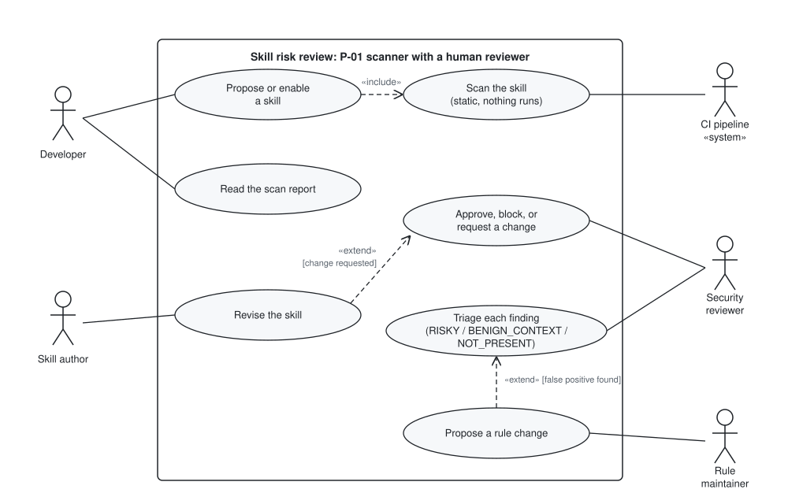
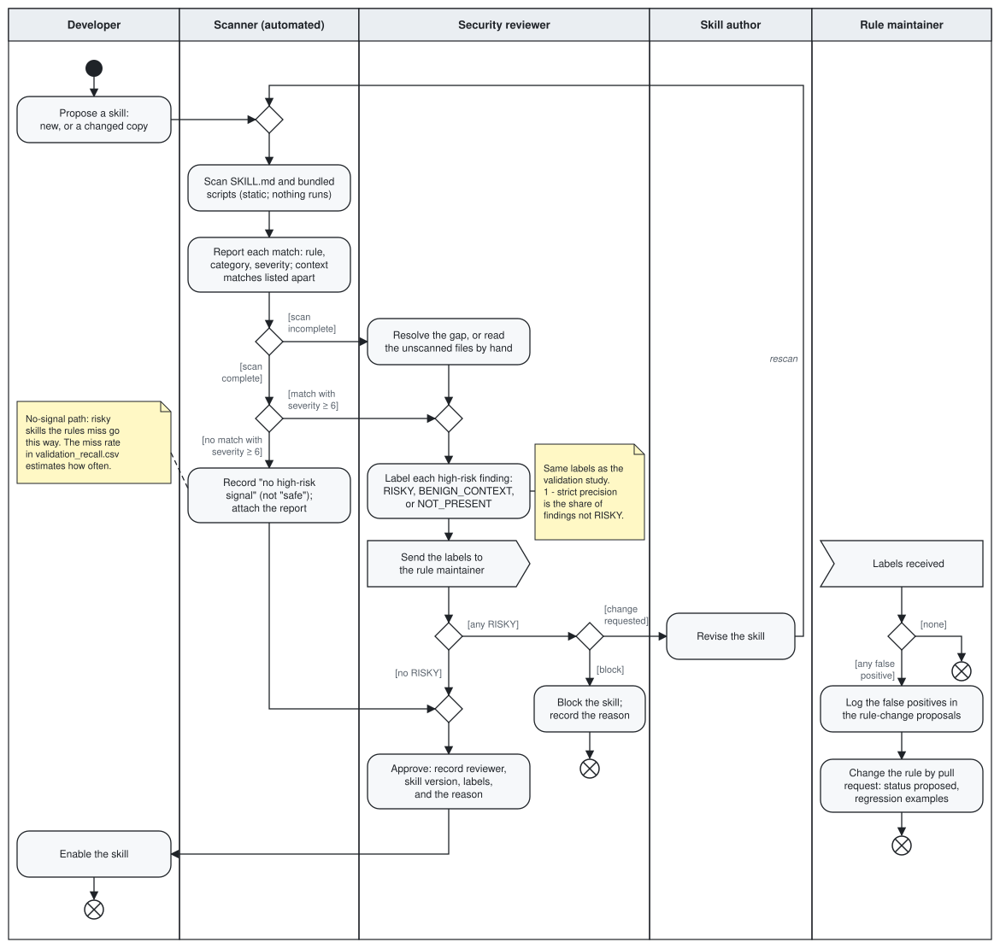

# Human-in-the-loop risk review: how the scanner is meant to be used

How to use: this page describes the intended use of the P-01 scanner: a person reviews a skill's high-risk findings before the skill is enabled. The instructor asked for it in the Sprint 1 feedback ("define the final human-in-the-loop risk-review workflow that will use the scanner's results"; see `docs/sprints/sprint-2/instructor-feedback.md`, F5). **Status: revised after team review (2026-10-25, #98).** Leticia Aderhold's and Hina Kramer's review comments are applied, and the open questions are recorded as decisions in section 6. It is a design. The pipeline today scans the GitSkills sample in batch, and no single-skill review tool is built. Regenerate the diagrams with `python scripts/make_workflow_diagrams.py`.

## 1. Why a person stays in the loop

- A skill is "copied like code and read like instructions" (`THREAT_MODEL.md` section 1). Users usually do not read every skill before an agent uses it (section 2), and the agent acts on the skill with the user's permissions (boundary 3).
- A rule match is a signal, not a verdict: it does not mean the skill is malicious or that the agent will act on it (`THREAT_MODEL.md` section 6). Many matches are benign in context.
- So the scanner should not block or allow skills on its own. It narrows a skill down to the few lines worth a person's attention, and a person makes the decision.

## 2. Actors

| Actor | Role in the workflow |
|---|---|
| Developer | Proposes adding a skill to a repository or enabling it for an agent: a new skill, or a copy of one from elsewhere |
| CI pipeline («system») | Runs the scanner when a pull request adds or changes a skill |
| Security reviewer | Triages each high-risk finding and approves, blocks, or asks for a change. Also approves a skill with no high-risk signal: every skill is enabled only after a reviewer approves it |
| Skill author | Revises the skill when a change is requested |
| Rule maintainer | Receives every set of triage labels and turns false positives into rule-change proposals |

In a small team one person can hold several roles, but the reviewer is never the developer who proposed the skill, the same separation the repository uses for pull-request review.

## 3. Use case diagram

| Use case | Actor | Notes |
|---|---|---|
| Propose or enable a skill | Developer | Always includes a scan («include») |
| Scan the skill | CI pipeline | Static only: SKILL.md and bundled scripts are read as text and matched against `rules/skill_risk_rules.yaml`. Nothing is executed, imported, or fetched. Matches below severity 6 are reported as context, apart from the findings |
| Read the scan report | Developer | Rule, category, severity, and the matched line for each finding |
| Triage each finding | Security reviewer | One label per finding (RISKY, BENIGN_CONTEXT, or NOT_PRESENT), using the decision order in `docs/validation/ANNOTATION_GUIDELINE.md` |
| Approve, block, or request a change | Security reviewer | The reviewer, the skill version, the labels, and the reason are recorded |
| Revise the skill | Skill author | Extends the decision when a change is requested; the revised skill is scanned again |
| Propose a rule change | Rule maintainer | Extends triage when a finding is a false positive; follows the rule-change process in `docs/validation/README.md` |

## 4. Activity diagram

1. The developer proposes a skill: a new one, or a changed copy of an existing one. A copy is scanned on its own; it does not inherit an earlier approval of a different copy. RQ3 shows why: copies of the same skill can differ in their high-risk categories (`results/rq3_summary.csv`).
2. The scanner reads SKILL.md and the bundled scripts and reports every rule match with its rule, category, and severity. Matches below severity 6, such as a shell code block (R-SHL-001), are listed in a separate context section of the report and are not findings to triage.
3. If the scan is incomplete, because a bundled file is missing or unreadable or the folder listing is truncated, the skill does not take the no-signal path. The reviewer resolves the gap (for example, fixes the file so it can be rescanned) or reads the unscanned files by hand, and then triages as in step 5.
4. If no match has severity 6 or more (the threat model's "high risk"), the report records "no high-risk signal". That is not a statement that the skill is safe: this path is where the scanner's misses go. The reviewer still approves the change, as in step 7.
5. Otherwise the reviewer labels each high-risk finding RISKY, BENIGN_CONTEXT, or NOT_PRESENT, and the labels are sent to the rule maintainer.
6. If any finding is RISKY, the reviewer either blocks the skill and records why, or asks the author for a change. A revised skill is scanned again from step 2.
7. With no RISKY finding, the reviewer approves and records who reviewed, the skill version (its content hash), the labels, and the reason. The developer then enables the skill.
8. Separately, the rule maintainer receives every set of labels. Any false positive (NOT_PRESENT, or BENIGN_CONTEXT that the rule could have told apart) is logged with `python scripts/annotation_kit.py proposals` (`docs/validation/RULE_CHANGE_PROPOSALS.md`), and the rule is changed by pull request with regression examples. The diagram shows this as a signal the reviewer sends, so neither an approval nor a block ends the rule maintenance, and every path ends in a flow final node.

## 5. How the validation study measures this workflow

The triage labels are the validation labels, so the Sprint 2 validation numbers describe how this workflow would behave on the GitSkills sample. The signals and drift results below come from round 1 (#119); lineage results come with #124.

| Validation result | What it says about the workflow | Round 1 result |
|---|---|---|
| Strict precision per rule and category (`results/validation_precision_by_rule.csv`, `..._by_category.csv`) | The share of findings a reviewer would label RISKY. One minus it is the share of findings not labelled RISKY. It is not a measure of reviewer time, which was not measured | By category, from 0.20 (DYNAMIC_EXEC) to 1.00 (TOOL_GRANT) |
| Miss rate (`results/validation_recall.csv`) | How often a risky skill takes the no-signal path in step 4 and reaches approval without triage | 0 of 40 no-signal items missed (95% CI 0 to 0.088); at the upper bound, about 661 of the 7,540 no-signal contents |
| Inter-rater agreement (`results/validation_agreement.csv`) | Whether two reviewers given the same guideline reach the same label | Drift: 83.3% agreement, kappa 0.745, 18 pairs. This is agreement on why two copies differ, not on signal triage, so it does not show that two reviewers make the same triage decisions. Signals have one rater; the intra-rater check is in Sprint 3 (#101) |
| Lineage precision and drift types (`results/validation_lineage.csv`, `results/validation_drift.csv`) | Whether "copies of the same skill" are really related, and what kind of change made a copy's risk differ: the case for rescanning every copy in step 1 | Drift: 8 template updates, 8 local adaptations, 2 hardening, no capability additions. Lineage: #124 |
| Severity sensitivity at cutoffs 5 and 7 (`results/sensitivity_summary.csv`) | How many skills reach a reviewer if the threshold in step 4 moves | Contents with a high-risk match: 1,946 at cutoff 5, 1,159 at 6, 355 at 7 |

## 6. Decisions after team review, and what is not built

Leticia Aderhold and Hina Kramer reviewed the draft on 2026-10-24 (#98). Their answers to the open questions, and the corrections they asked for, are recorded here and applied above.

| Question or comment | Decision |
|---|---|
| Threshold: is severity 6 right? | Keep severity 6, provisionally. Before changing it, compare the findings at cutoffs 5 and 7 (section 5). Reviewer workload has not been measured, so it cannot settle the question yet |
| Context rules below severity 6 | Shown in a separate context section of the scan report, not as high-risk findings (step 2) |
| Who reviews in a three-person team? | A member other than the person proposing the skill. The record names the reviewer, the skill version, the decision, and the reason (step 7) |
| Who authorizes a skill with no high-risk signal? | The reviewer, as for any change. "No high-risk signal" never means the skill is safe (step 4) |
| Failed or incomplete scans | A separate outcome that needs resolution or manual reading; a missing or unreadable file never takes the no-signal path (step 3) |
| Block versus revise | Separate outcomes: a block ends the review with a recorded reason; a change request goes to the author and the revised skill is rescanned (step 6) |
| Parallel rule maintenance | Modelled as a signal to the rule maintainer, with flow final nodes on every path, so enabling or blocking a skill does not end it (step 8) |
| Label names | BENIGN_CONTEXT in both diagrams, as in the guideline |
| Interpretation of the validation numbers | One minus strict precision is the share of findings not labelled RISKY, not reviewer time; drift agreement is not triage agreement (section 5) |

**Not built:** a command that scans one skill folder and prints a report; storage for reviewer decisions; any enforcement in an agent runtime. The batch pipeline (`python -m msr_pipeline analyze`) is what exists. This page describes the proposed workflow, not the implemented pipeline.
